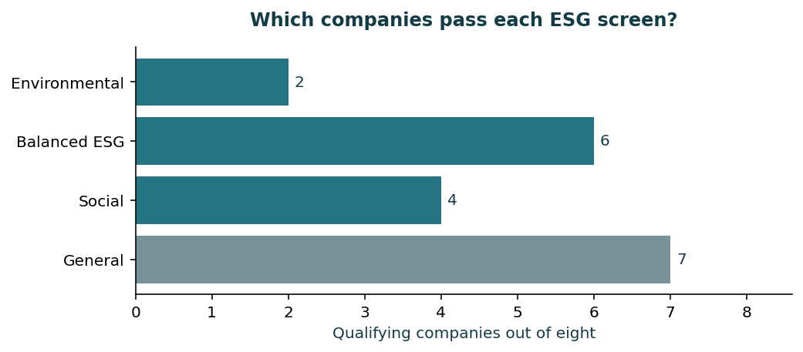

# GreenFolio

GreenFolio explores what happens to a portfolio when you change a sustainability preference. A user chooses a risk profile and an environmental, social or broader ESG preference, then inspects the holdings and their historical performance.

## Follow the portfolio

The profile determines the investment preferences. The construction view filters the equity universe and builds the allocation. Two further views show the portfolio's ESG exposures and its return, volatility and drawdown against a selected benchmark.

The live builder retrieves price and sustainability data through Yahoo Finance. Availability varies by ticker. The source and missing-data behaviour are described below.

## One universe, four preferences

I ran the four screening rules on the same eight fictional companies. The environmental screen admitted two, the balanced ESG screen admitted six, the social screen admitted four and the general screen admitted seven. Lower risk scores are better. You can change a single company's inputs and see which threshold it crosses. [Offline example](example.py)



## Check a screen by hand

| Preference | Conditions, all of which must hold | Passing companies |
| --- | --- | --- |
| Environmental | Environmental < 4, total < 20, social and governance both < 12 | A, C |
| Balanced ESG | Total < 22, each component < 10, and at least one of environmental < 8, social < 8 or governance < 5 | A, B, C, E, F, G |
| Social | Social < 8, governance < 6 and total < 25 | B, C, E, G |
| General | Total < 25 and every component < 15 | A, B, C, D, E, F, G |

Company G has scores of 4, 4 and 4 and a total of 12. It passes the social and balanced screens. Its environmental score equals the environmental cutoff, which requires a value strictly below 4. That one observation explains a difference that is easy to miss in a count chart.

The opening **Screen comparison** runs offline. **Portfolio builder** uses provider data when available. Missing provider scores are excluded by default. A sidebar switch can include clearly identified illustrative defaults to explore how missing data change the investable universe. [Exact selection rules](screening.py) · [Market data and performance metrics](data_manager.py) · [Portfolio charts](visualization.py)

## Run locally

```sh
python -m pip install -r requirements.txt
python -m streamlit run app.py
```

For the offline comparison, run `python example.py`. It reads no market feeds.

Tom Bussard
